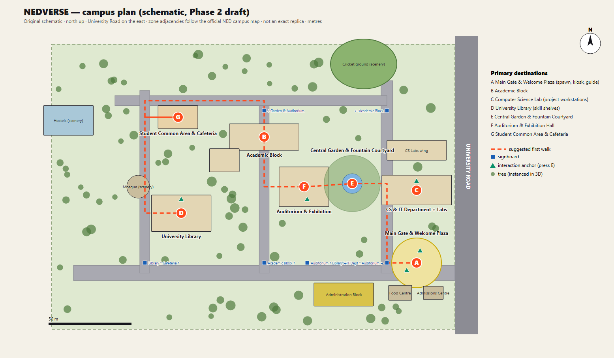

# NEDVERSE — Phase 2: Campus design, references, architectural direction, asset plan

Date: 2026-11-21. Status: **design only — no 3D code written.** Waiting for approval (questions in §10).
Brand: **AIMVERSE** is the portfolio; **NEDVERSE** is this Quest Mode. Required disclaimer shown in the entry screen, pause menu and footer of the experience:
*"NEDVERSE is an unofficial, student-created digital exploration experience. It is not affiliated with or endorsed by NED University of Engineering & Technology."*
No official NED logo and no imitation of it (e.g. the gate's circular emblem becomes a blank plaque). "NED University of Engineering & Technology" appears only as a factual place name in text.

## 1. Evidence used (and what each gave us)
| Source | What it provided | Limits |
|---|---|---|
| **Official campus map** (`neduet.edu.pk/campus-map`, downloaded, local only) | The real adjacency of ~30 numbered buildings, roads, entrances on University Road (east edge), ovals/sports at NE, hostels W, mosque near library, courtyard fountain beside the auditorium | Schematic drawing, no scale bar, no heights or facades |
| Satellite image (`/satellite_image`) | Confirms dense mature tree cover, road grid, ovals; low resolution | Cropped, hazy; not usable for facades |
| NED "Facilities" + "Academic & allied facilities" pages | **550-seat auditorium**, 140 classrooms/6 smart rooms/8 lecture halls, Engr. Abul Kalam Library (87,967 books, 692 journals), mosque, five canteens, convocation ground, day-care, shuttle from "Main Gates" | University-wide; most items not tied to a campus or position |
| Sustainability Report 2020 (text extracted locally) | Tree plantation drives (neem, coconut palms), solar panels on department roofs, grey-water for department gardens, pedestrian street lamps, Green Society | Not a layout document |
| UG Prospectus 2025 (image-only PDF, scanned pages checked) | Course content/history; no campus drawings | No text layer (OCR not available) |
| **Your 3 photos** | The real look: main gate arch, a cream 3-4 storey block with a concrete-frame monument and garden, a cluster of low cream pavilions on a loop road | **Unlabelled** — see §10 |
| Not available | NED photo gallery is "Coming Soon"; no official 3D/architectural data | Hence "NED-inspired", labelled unofficial |

## 2. Real-map → NEDVERSE zone mapping (what we take, what we invent)
| Zone | Based on (official map) | In NEDVERSE |
|---|---|---|
| **A Main Gate & Welcome Plaza** | Entrance on University Road next to Admissions Centre (25), Food Centre (26), Administration Block (27) | Gate arch (from your photo), plaza with welcome kiosk + guide, signboards, Admissions/Food Centre pavilions, Administration Block as a yellow-trimmed landmark |
| **B Academic Block** | Central department blocks (12/13/15 area: classrooms, lecture halls) | Cream 3-storey block with courtyard; walk-through ground floor; destination objective only |
| **C Computer Science Laboratory** | **Building 5 "Depts. of Comp. Sc. & I.T. and Maths & Basic Sciences" + 5A "Labs of CSIT Dept."** — east side, north of the entrance | Lab building; interior (lazy-loaded) with 5 project workstations + 6th creative-motion desk |
| **D University Library** | "Circulation Library" / "Reference Library" west-centre, beside the mosque; official name *Engr. Abul Kalam Library* | Library building with reading terrace; 6 skill shelves |
| **E Central Campus Garden** | Courtyard with fountain (6) between auditorium and girls' common room, big central lawns | Fountain courtyard + lawns, benches, flowering beds, trees |
| **F Auditorium & Exhibition Hall** | Building 11 "Auditorium" beside courtyard (550 seats per NED facilities page) | Hall with foyer used as the exhibition space (exhibition hall itself is a design approximation) |
| **G Student Common Area** | Students' Cafeteria, Food Centre, Girls' Common Room (7), canteens | Open terrace with tables, canteen kiosk; destination only |
| Scenery (non-enterable) | Mosque, hostels, cricket ground/track, masjid, other departments | Silhouettes/low-detail background so the world feels like a campus |
Distances are **compressed ~4×** so a full tour takes a few minutes at walking speed; orientation (north up, University Road east) is kept so NED students recognise the arrangement.

## 3. Top-down layout

Files: `nedverse/campus_plan.svg`, `nedverse/layout.json` (will become `campus/layout.ts`: roads, building footprints, signboards, route, interaction anchors — single source for the world, collisions, mini-map and objectives). Generator: `scripts/make_campus_plan.py`.

**Suggested first walk:** A → C (projects) → E → F (achievements) → B → G → D (skills). Every junction has a signboard (11 planned) and a destination marker on the mini-map; nothing is hidden.

## 4. Visual direction — "realistic stylised"
**Reading of your photos**
- Walls: warm **cream / ivory plaster** (≈ `#E6D9B8`, sunlit `#F0E4C4`), sandy gate piers (≈ `#C9BD9D`).
- **Flat roofs with deep parapets/fascias**; vertical window bays with dark green-grey frames; some projecting concrete window hoods (cluster pavilions); concrete-frame monument slabs (garden).
- **Yellow-and-black striped kerbs** along roads and islands (≈ `#E9B800` / `#1B1B1B`) — a strong, recognisable NED detail.
- Mature broadleaf trees with dense dark canopies (≈ `#2F4A28`, `#5B6530`), flowering shrub beds (pink/magenta), lawns (≈ `#5F8F3A`), park benches, low bollard lamps, tall street lamps.
- Sky: clear blue morning gradient; low warm sun (photo 4).

**Rendering approach (no heavy assets):** procedurally modelled buildings from proportioned boxes + parapets + window-bay textures drawn in-engine (canvas), plaster normal/roughness noise, concrete trim, glass with reflection tint, asphalt + painted kerbs, instanced trees (3 canopy variants), shrubs, benches, lamps. Directional sun with soft shadow map covering the walkable area, hemisphere fill, light fog. Three lighting presets: Morning (default), Noon, Evening (sunset + lit windows).
**Avoid:** neon, floating islands, low-poly cartoon look, empty spaces (ambient people are *optional silhouettes*, no NPC logic).

## 5. Zone-by-zone architecture notes
- **Gate (A):** portal-frame arch spanning the road, two thick piers each side with side blocks (guard rooms), lettering band reading the factual name, blue "MAIN GATE — IN" sign, striped kerbs, blank round plaque on a pier (no emblem).
- **CS & IT (C):** cream 3-storey block, long horizontal parapet bands, repeated vertical window bays, covered entrance porch; adjacent single-storey lab wing; roof AC units/solar rack optional (*solar on some NED department roofs is in the sustainability report; I will not claim it for CS*).
- **Library (D):** 3-storey cream block, deeper windows, reading terrace with trees; interior not modelled — skill "shelves" are an exterior-facing reading hall (lazy-loaded small interior).
- **Auditorium (F):** wide hall with curved foyer glazing and a canopy; foyer hosts 8–10 exhibition panels.
- **Garden (E):** fountain courtyard (circular basin per map), curved paths, flower beds, benches, concrete-frame monument slabs (from your photo).
- **Common area (G):** open-air terrace, shaded seating, canteen kiosk, string lights in Evening preset.

## 6. Asset plan and performance budget
| Item | Method | Budget |
|---|---|---|
| Terrain/roads/paths | one tiled ground mesh + painted decals | ≤ 4k tris, 2 × 1024² textures |
| Buildings (7 zones + ~12 scenery) | procedural boxes, shared window/plaster atlas | ≤ 60k tris total; textures 1×2048² atlas + 1×1024² |
| Vegetation | instanced (3 tree types, 2 shrub types, grass cards near player) | ≤ 400 trees, LOD to billboards beyond ~60 m |
| Props (benches, lamps, bins, signs, kiosk) | instanced primitives | ≤ 20k tris |
| Avatar | existing GLB (670 KB) + new walk/run clips | unchanged mesh |
| Interiors (CS lab, library hall, exhibition foyer) | **lazy-loaded** modules, unmounted when outside | each ≤ 15k tris |
| Shadows | 1 directional, 1024² (512² on low tier) | tiers: High / Low / **List-only fallback** (current no-WebGL path) |
| Whole experience | lazy chunk; portfolio scene **unmounted** while open | target ≥ 45 fps mid laptop, ≥ 30 fps mid phone (to be measured on real hardware) |
No external stock assets or downloads are needed; nothing from NED's site is redistributed (reference imagery stays local, git-ignored).

## 7. Player and controls (preview of Phase 4)
Third-person, camera damped follow + mouse orbit/touch drag, circle-vs-box collision on a flat campus, ground snap, WASD / Shift run / E interact / Esc pause, virtual joystick + contextual action button. **Avatar:** option C — author real **walk and run** cycles in Blender on the existing rig (no change to mesh/materials/proportions) and blend Idle ⇄ Walk ⇄ Run in code with turn smoothing; procedural leg/arm swing is the fallback if an authored clip misbehaves.

## 8. Experience rules (from your prompt) — all honoured by design
No timers, scores, lives, combat, puzzles, hidden objects/portals/collectibles; every objective is shown on the objective panel + mini-map; exit to the standard AIMVERSE portfolio always available; reduced-motion and mute controls; progress in localStorage with reset.

## 9. Content mapping (same data as the portfolio — no duplicates)
- **CS Lab workstations** (from `data.ts` islands): Game Development · Cybersecurity · VR & XR · AI & Computer Vision · **Web Development only if a verified web project fits** (Orb Rush is a 3D web game and CYBERVERSE is WebGL — I propose placing them where they already live, not forcing a Web desk; tell me if you want a Web desk using specific projects) · **Creative Motion** as the 6th desk. Each opens one reusable project panel (title, thumbnail, description, tech, contribution, solo/team, media, verified link) with "Open full project".
- **Library shelves:** your six real categories (Game & Immersive, Programming, 3D & Web, AI & Computer Vision, Backend & Databases, Creative & Tools) with the projects that use each skill. No "CS Fundamentals".
- **Auditorium panels:** only facts you have given (Speech competition winner, matriculation 98.3% position holder, CEGA training, KDA internship, projects/events already in the data) + any certificates/photos you send.

## 10. What I need before Phase 3 (environment prototype)
1. **Label your three photos** (what/where): photo 1 = main gate (I believe); photo 2 = ? (cream block + monument + lawn); photo 3 = ? (low pavilions around a loop road — hostel/staff housing or something else?).
2. **More photos if you can:** CS department entrance/front, library front, auditorium front, a garden/common area, the Admin Block. Even 1–2 per place greatly improves accuracy. Certificates for the exhibition hall.
3. **Entrance choice:** the official map has two University Road entrances. I plan the spawn at the south-east one (by Admissions/Food Centre). Is the gate in your photo that entrance?
4. **Promo timing:** one re-render **at the end** (after NEDVERSE exists, using new screenshots) vs. one now plus another later. I recommend once at the end; until then the live promo keeps the old branding, so I will **not** push the rebrand live until you decide (or I can push with the promo button hidden).
5. Approve this Phase 2 design (layout, mapping, visual direction, budgets).

Phase 3 then builds a small representative section only — the **Main Gate & Welcome Plaza with one building and trees**, lit in the Morning preset — and I will show screenshots before expanding.
